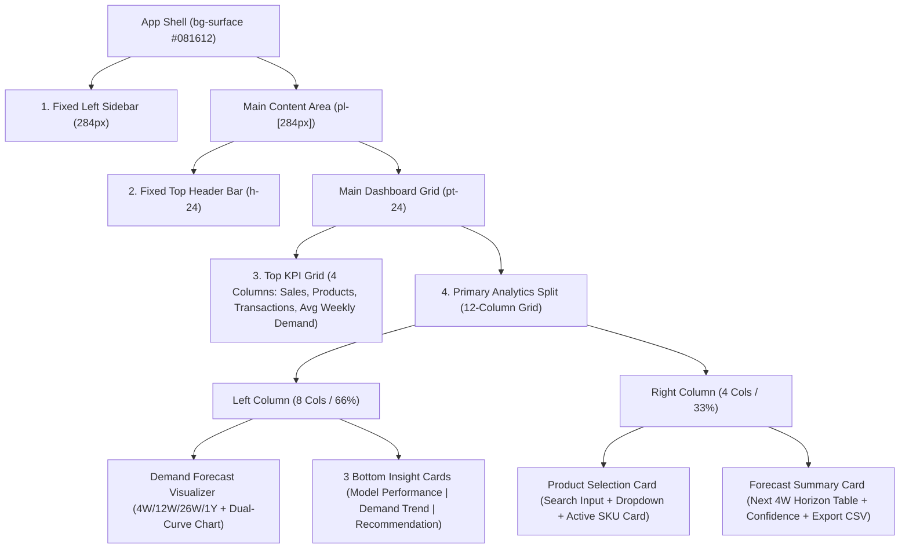

# DemandLens Frontend Design Analysis & Main Dashboard Implementation Plan

---

## 1. Overview of the Uploaded Stitch Design Package

The uploaded folder ([stitch_demandlens_frontend_implementation_plan](file:///c:/Users/moham/OneDrive/Bureau/meriem's%20project/DemandLens/stitch_demandlens_frontend_implementation_plan/stitch_demandlens_frontend_implementation_plan)) contains **1 design system specification** and **7 screen modules** (each with a reference `code.html` and `screen.png`):

| Module Folder | Role in Platform |
| :--- | :--- |
| [emerald_intelligence/DESIGN.md](file:///c:/Users/moham/OneDrive/Bureau/meriem's%20project/DemandLens/stitch_demandlens_frontend_implementation_plan/stitch_demandlens_frontend_implementation_plan/emerald_intelligence/DESIGN.md) | Master design tokens: color palette, 3-font typography scale, spacing, elevation, and component guidelines. |
| [demandlens_trend_forecast_insight_cards_phase_7](file:///c:/Users/moham/OneDrive/Bureau/meriem's%20project/DemandLens/stitch_demandlens_frontend_implementation_plan/stitch_demandlens_frontend_implementation_plan/demandlens_trend_forecast_insight_cards_phase_7/code.html) | **Main Dashboard (`/` — Focus of this plan)**: Executive KPI row, 8:4 split workspace with Demand Forecast chart, 3 bottom insight cards, Product Selection, and Forecast Summary table. |
| [demandlens_product_explorer](file:///c:/Users/moham/OneDrive/Bureau/meriem's%20project/DemandLens/stitch_demandlens_frontend_implementation_plan/stitch_demandlens_frontend_implementation_plan/demandlens_product_explorer/code.html) | **Product Explorer**: Catalog SKU inventory table, stockout risk alerts, and category velocity leaders. |
| [demandlens_sales_analytics](file:///c:/Users/moham/OneDrive/Bureau/meriem's%20project/DemandLens/stitch_demandlens_frontend_implementation_plan/stitch_demandlens_frontend_implementation_plan/demandlens_sales_analytics/code.html) | **Sales Analytics**: Gross revenue vs. target trajectory, category margins, top SKUs, and regional momentum. |
| [demandlens_demand_forecasting](file:///c:/Users/moham/OneDrive/Bureau/meriem's%20project/DemandLens/stitch_demandlens_frontend_implementation_plan/stitch_demandlens_frontend_implementation_plan/demandlens_demand_forecasting/code.html) | **Demand Forecasting**: Multi-horizon P10/P50/P90 confidence cones, price/promo scenario sandbox, and replenishment schedule. |
| [demandlens_model_evaluation](file:///c:/Users/moham/OneDrive/Bureau/meriem's%20project/DemandLens/stitch_demandlens_frontend_implementation_plan/stitch_demandlens_frontend_implementation_plan/demandlens_model_evaluation/code.html) | **Model Evaluation**: Backtest accuracy (`MAE`, `RMSE`, `MAPE`), ensemble weights, category volatility table, and SHAP importance. |
| [demandlens_data_quality](file:///c:/Users/moham/OneDrive/Bureau/meriem's%20project/DemandLens/stitch_demandlens_frontend_implementation_plan/stitch_demandlens_frontend_implementation_plan/demandlens_data_quality/code.html) | **Data Quality**: Ingestion throughput/latency bar chart, schema conformance, and anomaly quarantine rules. |
| [demandlens_settings_platform_configuration](file:///c:/Users/moham/OneDrive/Bureau/meriem's%20project/DemandLens/stitch_demandlens_frontend_implementation_plan/stitch_demandlens_frontend_implementation_plan/demandlens_settings_platform_configuration/code.html) | **Settings**: Data pipeline sync parameters, retraining cadence, connectors, API keys, and alert thresholds. |

---

## 2. Core "Emerald Intelligence" Design System

Currently, the Next.js app in [frontend/src/](file:///c:/Users/moham/OneDrive/Bureau/meriem's%20project/DemandLens/frontend/src) uses a **dark violet (`#0B0B16` / `#171728` / `violet-*`)** theme with `Geist` fonts. The Stitch design transitions the application to the **Emerald Intelligence** design language:

### A. Layered Chromatic Dark Surfaces & Semantic Accents
- **Surface Hierarchy**:
  - `surface` / `background`: `#081612` (Main app canvas)
  - `surface-container-lowest`: `#04110d` (Fixed sidebar background & recessed pill tracks)
  - `surface-container-low`: `#101e1a` (Primary card containers)
  - `surface-container`: `#14221e` (Nested sub-cards, inputs, hover rows)
  - `surface-container-high`: `#1f2d28` (Icon badges, dropdown flyouts, floating tooltips)
  - `surface-variant`: `#293833` (Active sidebar route fill & dropdown item hover)
- **Time-Domain & Semantic Accents**:
  - **Primary / Historical Actuals (`#4edea3` & `#10b981`)**: Bioluminescent emerald/mint used for historical sales curves, active states, and primary action buttons.
  - **Tertiary / Forecast Projections (`#98da27` & `#b2f746`)**: Kinetic lime exclusively reserved for predicted demand curves, forecast horizon shading, positive KPI delta badges, and AI recommendations.
  - **Error / Negative Delta (`#ffb4ab` / `#93000a`)**: Soft coral on dark red container for downward shifts (e.g., `-2.0%` in W12).
- **Borders & Text**:
  - `on-surface`: `#d6e6df` (Primary text)
  - `on-surface-variant`: `#bbcabf` (Secondary labels)
  - `outline`: `#86948a` (Muted metadata, units, axes)
  - `outline-variant`: `#3c4a42` (Subtle `1px` card borders, typically at `40%–60%` opacity, elevating to `primary/40` on hover)

### B. Tri-Font Typography System & Iconography
1. **`Space Grotesk`** (`headline-xl`, `headline-lg`, `headline-md`, `headline-sm`, `metric-display`): Used for brand headers, section titles, and large KPI numbers (`28px` bold, `-0.03em` tracking).
2. **`Inter`** (`body-lg`, `body-md`, `body-sm`, `label-caps`): Used for UI chrome, descriptions, navigation links, and uppercase pill badges.
3. **`JetBrains Mono`** (`data-mono-lg`, `data-mono-sm`): Used for SKUs, axis ticks, horizon week labels (`W1`–`W12`), `⌘ K` keycaps, and model error metrics (`MAE`, `RMSE`).
4. **Google Material Symbols Outlined**: Used consistently across sidebar navigation, KPI card badges, trend arrows (`trending_up`, `trending_down`), and action buttons.

---

## 3. Structural Breakdown of the Main Dashboard

Based on [demandlens_trend_forecast_insight_cards_phase_7/code.html](file:///c:/Users/moham/OneDrive/Bureau/meriem's%20project/DemandLens/stitch_demandlens_frontend_implementation_plan/stitch_demandlens_frontend_implementation_plan/demandlens_trend_forecast_insight_cards_phase_7/code.html), the Main Dashboard is organized into **4 structural zones**:

### Zone 1: Fixed Left Sidebar (`284px`)
- **Brand Block**: `54×54px` emerald-glowing `bar_chart` badge + `DemandLens` (`Space Grotesk`) + `Retail Intelligence Platform` subtitle.
- **Background Graphic**: Subtle `10%` opacity triple-wave SVG at the bottom of the sidebar.
- **Primary Navigation (6 Routes)**:
  1. `Dashboard` (`home` icon — active state with `bg-surface-variant text-primary border-primary/30` and emerald glow)
  2. `Product Explorer` (`inventory_2`)
  3. `Sales Analytics` (`analytics`)
  4. `Demand Forecasting` (`trending_up`)
  5. `Model Evaluation` (`military_tech`)
  6. `Data Quality` (`database`)
- **Bottom Utility Navigation (2 Routes)**: `Settings` (`settings`) and `Help & Docs` (`help`) separated by a top border.

### Zone 2: Fixed Top Header (`h-24`)
- **Left Greeting**: `Welcome to DemandLens 👋` (`headline-xl`) + subtitle `Explore sales, analyze demand, and forecast future product demand.`
- **Right Controls**:
  - Global search input (`w-[480px]` on `xl`) with `search` icon and `⌘ K` monospace badge.
  - Notification bell button with glowing primary unread dot.
  - User profile pill (`SA` avatar badge + chevron).

### Zone 3: Top KPI Metric Row (4 Cards, `xl:grid-cols-4`)
Each card sits on `bg-surface-container-low` (`#101e1a`), features a `48×48px` icon container on the top-left, a lime delta pill (`+X.X%` with `trending_up`) on the top-right, the metric label, and the large value + unit label:
1. **Total Sales**: `database` icon | `+12.4%` | Value (`units`)
2. **Total Products**: `inventory_2` icon | `+4.8%` | Value (`unique items`)
3. **Total Transactions**: `shopping_cart` icon | `+9.1%` | Value (`orders`)
4. **Avg. Weekly Demand**: `trending_up` icon | `+11.2%` | Value (`units per product`)

### Zone 4: Primary 12-Column Analytics Split (`lg:grid-cols-12`)

#### **Left Column (`lg:col-span-8`)**
1. **Demand Forecast Card (Main Time-Series Visualizer)**:
   - **Header**: `bar_chart` badge, title `Demand Forecast`, subtitle `Historical sales vs. predicted demand for the selected product.`, and **Segmented Range Selector** (`4W`, `12W`, `26W`, `1Y`).
   - **Chart Canvas**:
     - Rotated Y-axis title `Demand (Units)`, dashed horizontal gridlines, monospace Y-axis and X-axis (`W1`–`W12`) labels.
     - **Historical Series (`W1`–`W8`)**: Solid `#4edea3` stroke (`2.5px`), circular nodes, and emerald vertical area gradient (`#demandHistoryGrad`).
     - **Forecast Boundary & Series (`W8`–`W12`)**: Vertical dashed `#98da27` divider line, shaded forecast period box (`fill="#98da27" fill-opacity="0.05"`), dashed `#98da27` curve, lime area gradient (`#demandForecastGrad`), and floating callout badge (`W10 (Forecast) / 2,380 units`).
   - **Legend Footer**: `Historical Demand` (emerald dot), `Predicted Demand` (lime dashed line), `Forecast Period` (lime shaded box).
2. **Bottom 3 Insight Cards (`md:grid-cols-3`)**:
   - **Panel 1 — `Model Performance`**: `verified` icon + info tooltip, subtitle, and 2 side-by-side metric boxes (`MAE ERROR` with delta vs. baseline, `RMSE SPREAD` with `Optimal zone` label).
   - **Panel 2 — `Demand Trend`**: `trending_up` icon, `+13.6%` pill badge, headline `+13.6% vs. previous 12 weeks`, and a bottom sparkline area.
   - **Panel 3 — `Recommendation`**: `lightbulb` icon, `#REC-4091` tag, callout box (`Increase inventory by ~12% to meet the expected demand...`), and footer with `RECOMMENDED ALLOCATION` + `Apply →` action button.

#### **Right Column (`lg:col-span-4`)**
1. **Product Selection Card**:
   - **Header**: `inventory_2` icon + `Product Selection` title + subtitle.
   - **Search Combobox**: Search icon, input field, clear (`close`) button, and floating dropdown menu showing matching products with thumbnail/icon, product name, `SKU: ...` monospace subtitle, and `Active` / `Select` status.
   - **Selected Product Highlight Card**: Displays the currently active product's thumbnail/icon, title, SKU metadata, and solid emerald `✓ Active` badge.
2. **Forecast Summary Card**:
   - **Header**: `track_changes` icon + `Forecast Summary` (`Predicted target units (Next 4W)`) + `Auto-refresh` badge.
   - **Horizon Table (4 Rows: `W9`–`W12`)**: Each row displays the week code (`W9`–`W12`), date range, predicted units, and percentage change badge (`+8.1%`, `+11.2%` highlighted as peak row, `+3.4%`, `-2.0%` in coral error style).
   - **Footer**: `Confidence: 94.2%` indicator dot on the left and `Export CSV ↓` action button on the right.

---

## 4. Proposed Implementation Plan (Files to Create / Update)

> [!IMPORTANT]
> Per your instructions, **no code changes have been made yet**. Below is the exact file-by-file plan for transforming the current frontend into the Stitch Main Dashboard design once you approve.

### Phase 1: Design Tokens, Fonts & Icons Setup
- **[Modify] [layout.tsx](file:///c:/Users/moham/OneDrive/Bureau/meriem's%20project/DemandLens/frontend/src/app/layout.tsx)**:
  - Load `Space_Grotesk`, `Inter`, and `JetBrains_Mono` from `next/font/google` and bind CSS variables (`--font-space-grotesk`, `--font-inter`, `--font-jetbrains-mono`).
  - Include the Google `Material Symbols Outlined` stylesheet in `<head>` and update page metadata (`DemandLens — Retail Intelligence Platform`).
- **[Modify] [globals.css](file:///c:/Users/moham/OneDrive/Bureau/meriem's%20project/DemandLens/frontend/src/app/globals.css)**:
  - Register all **Emerald Intelligence** color tokens (`surface`, `surface-container-lowest`, `surface-container-low`, `surface-container`, `surface-container-high`, `surface-variant`, `primary`, `primary-container`, `secondary`, `tertiary`, `error`, `error-container`, `on-surface`, `on-surface-variant`, `outline`, `outline-variant`), font families, and custom typography utilities in Tailwind v4 `@theme`.

### Phase 2: App Shell (Sidebar & Top Header)
- **[Modify] [Sidebar.tsx](file:///c:/Users/moham/OneDrive/Bureau/meriem's%20project/DemandLens/frontend/src/components/Sidebar.tsx)**:
  - Upgrade to the `284px` `Emerald Intelligence` sidebar with the glowing `bar_chart` logo block, bottom layered wave SVG, 6 primary navigation items (`Dashboard`, `Product Explorer`, `Sales Analytics`, `Demand Forecasting`, `Model Evaluation`, `Data Quality`), 2 bottom utility links (`Settings`, `Help & Docs`), and accessible mobile drawer support.
- **[Create] `frontend/src/components/Header.tsx`**:
  - Implement the fixed `h-24` top bar with `Welcome to DemandLens 👋`, global product search input (`⌘ K` shortcut wired to focus/filter product search), notification bell button, and `SA` profile pill.

### Phase 3: KPI Grid & Main 8:4 Dashboard Workspace
- **[Modify] [StatCard.tsx](file:///c:/Users/moham/OneDrive/Bureau/meriem's%20project/DemandLens/frontend/src/components/StatCard.tsx)**:
  - Redesign into the Emerald KPI card with a `48×48px` Material Symbol icon badge, top-right trend delta pill (`+X.X%`), title, `Space Grotesk` metric display value, and unit label.
- **[Modify] [SalesChart.tsx](file:///c:/Users/moham/OneDrive/Bureau/meriem's%20project/DemandLens/frontend/src/components/SalesChart.tsx)**:
  - Upgrade into the **`Demand Forecast` Visualizer** card featuring:
    - Segmented horizon range switcher (`4W`, `12W`, `26W`, `1Y`) that dynamically slices the displayed historical window.
    - Dual-series chart rendering **Historical Demand** (solid `#4edea3` line + emerald area gradient) and **Predicted Demand** (dashed `#98da27` line + shaded forecast period + lime area gradient + peak forecast callout tooltip).
    - Bottom 3-item legend (`Historical Demand`, `Predicted Demand`, `Forecast Period`).
- **[Create] `frontend/src/components/InsightCards.tsx`**:
  - Implement the 3-column bottom insight row inside the left 8-column stack:
    1. **Model Performance Card** (`MAE ERROR` & `RMSE SPREAD` computed from the selected product's baseline evaluation or dataset backtest).
    2. **Demand Trend Card** (percentage trend vs. previous window + mini sparkline).
    3. **Recommendation Card** (automated inventory allocation recommendation based on predicted demand + interactive `Apply` button).
- **[Modify] [ProductSelector.tsx](file:///c:/Users/moham/OneDrive/Bureau/meriem's%20project/DemandLens/frontend/src/components/ProductSelector.tsx) & [ForecastCard.tsx](file:///c:/Users/moham/OneDrive/Bureau/meriem's%20project/DemandLens/frontend/src/components/ForecastCard.tsx)**:
  - Restructure into the right 4-column stack (`Product Selection` card with search input, clear button, rich dropdown, and `Active` selected product card; plus the `Forecast Summary` card with the 4-week horizon rows, confidence indicator, and working `Export CSV` download button) while coordinating state with the left 8-column chart and insight cards.
- **[Modify] [page.tsx](file:///c:/Users/moham/OneDrive/Bureau/meriem's%20project/DemandLens/frontend/src/app/page.tsx), [loading.tsx](file:///c:/Users/moham/OneDrive/Bureau/meriem's%20project/DemandLens/frontend/src/app/loading.tsx), & [error.tsx](file:///c:/Users/moham/OneDrive/Bureau/meriem's%20project/DemandLens/frontend/src/app/error.tsx)**:
  - Assemble the full 12-column Emerald Intelligence dashboard layout and update loading skeletons and error states to match the `#081612` emerald theme.

---

## 5. Key Alignment Questions Before Implementation

1. **Data Mode (Live Backend API vs. Stitch Mockup Data)**:
   - Should the dashboard drive all cards, charts, and tables from your **live FastAPI backend** (`weekly_sales.csv` & `baseline_evaluation.csv`), or would you like a hybrid approach (live backend data for product history/forecast + curated product names/metrics matching the Stitch screenshot when a demo SKU is selected)?
2. **Backend API Expansion (Optional)**:
   - Currently, [`GET /products`](file:///c:/Users/moham/OneDrive/Bureau/meriem's%20project/DemandLens/backend/main.py#L53-L62) returns `products[:10]` and [`GET /products/{stock_code}/forecast`](file:///c:/Users/moham/OneDrive/Bureau/meriem's%20project/DemandLens/backend/main.py#L91-L118) returns a single week's forecast. Would you like to keep the backend untouched (so all existing `tests/test_api.py` tests remain 100% unchanged) and compute the 4-week horizon/metrics on the frontend, or add optional fields/endpoints to FastAPI while preserving backward compatibility with `tests/test_api.py`?
